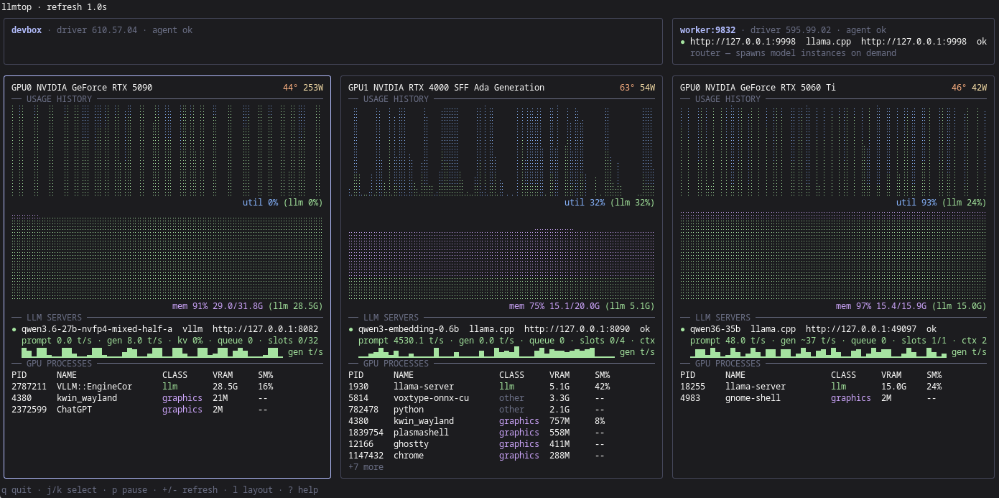
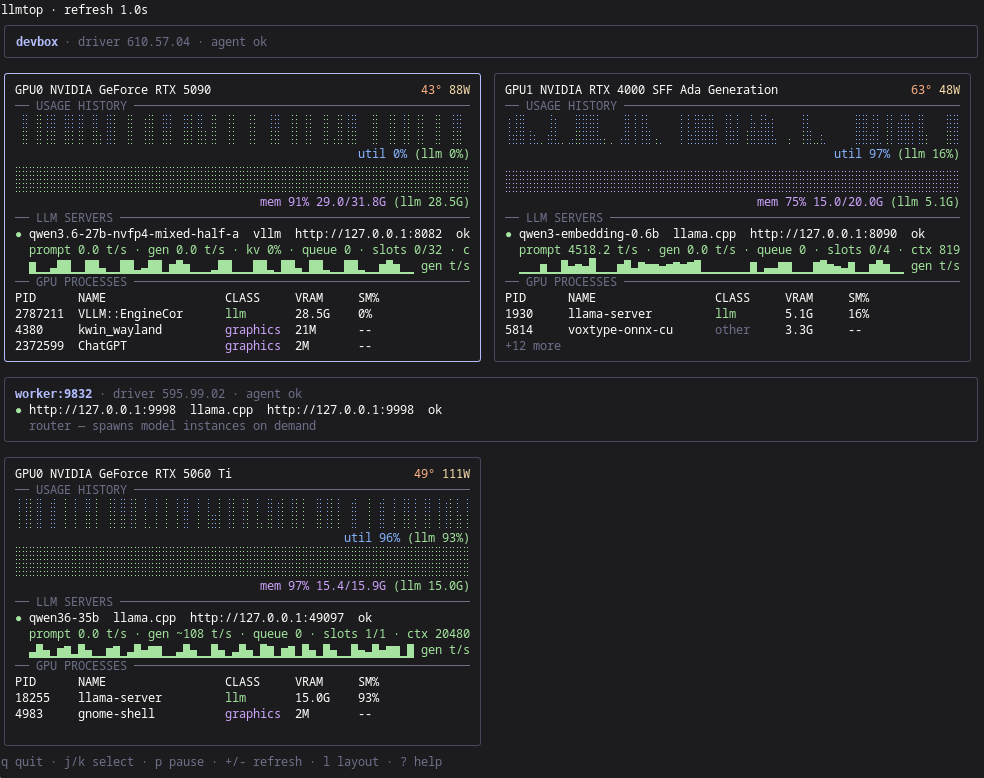

# llmtop

A [btop](https://github.com/aristocratos/btop)-style terminal UI for LLM
inference servers and the NVIDIA GPUs under them. `llmtop` charts per-GPU
utilization and memory the way [nvtop](https://github.com/Syllo/nvtop) does, and
on top of that shows what your
[llama.cpp](https://github.com/ggml-org/llama.cpp),
[vLLM](https://github.com/vllm-project/vllm) and
[NInfer](https://github.com/Neroued/ninfer) servers are doing — model loaded,
prompt and generation tokens/sec, KV-cache usage, slot occupancy — with GPU
usage split between LLM serving and everything else (compositor, browsers, other
compute). It watches the local machine and, through a small agent, any number of
remote GPU boxes in the same window.





## Requirements

- **Linux.** Process and server discovery read `/proc`; the agent ships as a
  systemd user unit. There is no macOS or Windows support.
- **NVIDIA GPUs** with the proprietary driver installed (`libnvidia-ml.so.1`,
  i.e. NVML). No AMD, Intel, or Apple GPU support.
- Runs as an unprivileged user; no root needed.
- **llama.cpp `llama-server`, vLLM (`vllm serve`) and NInfer (`ninfer-serve`)**
  are supported. The GPU-usage breakdown also counts SGLang and Ollama processes
  as "LLM", but throughput, KV-cache, and slot details are read from llama.cpp
  and vLLM only; NInfer has no metrics endpoint.
- **A terminal with a UTF-8 font that has braille and box-drawing glyphs** (the
  charts are drawn with braille). True colour is recommended; the UI degrades to
  fewer colours automatically.
- **To build:** Go 1.26+. A C toolchain (`gcc` or `clang`) is needed for the
  NVML bindings, which use cgo.

## Install

From source, into `${XDG_BIN_HOME:-$HOME/.local/bin}/llmtop`:

```bash
git clone https://github.com/mjacobs/llmtop && cd llmtop
make install
```

Or with the Go toolchain directly (installs to `$GOBIN` if set, else
`$(go env GOPATH)/bin`):

```bash
go install github.com/mjacobs/llmtop/cmd/llmtop@latest
```

Both build cgo-enabled by default, which is what you want for NVIDIA GPU
support. Go turns cgo off automatically when it cannot find a C compiler; if you
need GPU data, install `gcc` and the libc headers
(`dnf install gcc glibc-devel`, `apt install build-essential`) and build again.
The NVIDIA driver itself is only needed at **runtime**: the binary builds fine
on a machine with no GPU.

`make build` produces `./llmtop` in the checkout without installing;
`make uninstall` removes the installed binary. `make help` lists all targets.

## Quick start

```bash
llmtop                        # monitor this machine: auto-detected GPUs + llama.cpp/vLLM/NInfer servers
llmtop --connect host:9832    # also watch one remote llmtop agent, ad hoc
llmtop version                # print the version (also: llmtop --version)
```

Selecting, pausing, and changing the refresh rate are single keys — see
[Key bindings](#key-bindings). `?` shows them in the app.

## Remote hosts

Run the agent on each GPU box and point a TUI at it:

```bash
# on the remote box
llmtop agent --listen :9832

# on your workstation
llmtop --connect remote-host:9832
```

A `--connect` host is titled with the name its agent reports, which is that
machine's hostname, once the agent answers. To choose the title yourself,
declare the host in the config file with a `name` (see below).

To run the agent permanently as a systemd user service, install `llmtop` on that
host and install the included unit. The unit expects the binary at
`~/.local/bin/llmtop` (where `make install` puts it); if you used a custom
`XDG_BIN_HOME` or `go install` (`$GOBIN`, else `$(go env GOPATH)/bin` —
`command -v llmtop` tells you), change `ExecStart` in the copied unit to that
absolute path before enabling it:

```bash
mkdir -p ~/.config/systemd/user
cp contrib/llmtop-agent.service ~/.config/systemd/user/
systemctl --user daemon-reload
systemctl --user enable --now llmtop-agent
```

Run `loginctl enable-linger $USER` once if the service should survive logout and
run without an active login session. The unit does not override agent flags: the
listen address, token, and `refresh_ms` come from that host's
`~/.config/llmtop/config.toml` (or the built-in defaults when absent).
`refresh_ms` on the agent host sets how often it samples and how much history it
keeps (600 samples), which is the finest resolution any connected TUI can see
regardless of its own `+`/`-` setting.

`--connect` only works against agents running **without** a token — the TUI has
no `--token` flag. To reach an agent that requires one, declare the host in the
config file instead:

```toml
# workstation ~/.config/llmtop/config.toml
[[hosts]]
name  = "remote-host"
addr  = "remote-host:9832"
token = "some-shared-secret"   # must match the agent's token

# remote box ~/.config/llmtop/config.toml
[agent]
token = "some-shared-secret"
```

Keep the config file private (`chmod 600`) since it holds the shared secret.
`llmtop agent --token …` and the `LLMTOP_TOKEN` environment variable also work,
but a token on the command line is visible to every local user in the process
table, so treat `--token` as an ad-hoc option. Precedence is flag, then
environment, then config file.

`addr` and `--connect` accept a full URL, so an agent behind a TLS-terminating
reverse proxy is `addr = "https://gpu.example.com"`.

Uninstalling an agent host: `systemctl --user disable --now llmtop-agent`,
remove `~/.config/systemd/user/llmtop-agent.service`, then `make uninstall` (or
delete the binary that `command -v llmtop` points at, for a `go install` build),
and `rm -rf ~/.config/llmtop` if you want the config gone too.

## Commands and flags

| Command          | Flag                  | Meaning                                                                  |
| ---------------- | --------------------- | ------------------------------------------------------------------------ |
| `llmtop`         | `--config PATH`       | config file path (default `~/.config/llmtop/config.toml`)                |
| `llmtop`         | `--connect HOST:PORT` | connect to an agent ad hoc (repeatable; accepts a full `http(s)://` URL) |
| `llmtop`         | `--version`           | print the version and exit                                               |
| `llmtop agent`   | `--config PATH`       | config file path                                                         |
| `llmtop agent`   | `--listen ADDR`       | listen address (overrides config, default `:9832`)                       |
| `llmtop agent`   | `--token TOKEN`       | bearer token (overrides `LLMTOP_TOKEN` and config)                       |
| `llmtop version` |                       | print the version and exit                                               |

An explicit `--config` that does not exist is an error; the default path is
simply skipped when absent. Unknown subcommands and stray arguments are rejected
rather than silently starting the TUI.

## Configuration

`~/.config/llmtop/config.toml` (path overridable with `--config`). A flat
`~/.config/llmtop.toml` is also accepted when the canonical file does not exist
— the two are alternatives, never merged. No config file at all is equivalent to
monitoring only the local machine with defaults.

```toml
refresh_ms = 1000        # TUI poll and local sample cadence; on an agent host,
                         # the agent's own sample cadence and history depth

[ui]                      # display-only; never changes what is collected
show_addresses      = true # false: endpoints render as :port, error banners
                           # "!" error lines and server status text drop the
                           # configured address and every IP address (not
                           # decimal/hex/octal/zero-padded IPv4, name-shaped
                           # text like ip-192-0-2-10, or an address stuck to
                           # letters or digits; at most 8 "!" lines, each
                           # cut to 4 KB), address-only titles become host1…
show_hostnames      = true # false: every host title becomes host1, host2, …
show_graphics_procs = true # false: hide graphics-class rows in the process
                           # table (their VRAM stays in the purple mem total)

[layout]                 # preferred arrangement of the GPU panels
mode    = "auto"         # auto | one-row | stack-by-host | columns
columns = 3              # target column count: the arrangement under
                         # mode = "columns", and always an extra stop on the
                         # `l` key's cycle (columns alone implies that mode)

  [[layout.slots]]       # optional: an explicit panel order
  host = "gpu-box"       # a host's `name`
  gpu  = 1               # its GPU device index

  [[layout.slots]]
  host = "gpu-box"
  gpu  = 0

[[hosts]]                # omit ALL [[hosts]] entries to default to local-only
name  = "local"          # required on every host entry
local = true
gpus  = [1, 0]           # optional: show only these GPU indices, in this order
                         # (omit for all GPUs in device order)

  [[hosts.llm_endpoints]] # optional static additions for this (local) host
  url        = "http://127.0.0.1:8081"
  kind       = "llama.cpp" # engine: "llama.cpp" (default), "vllm", "ninfer"
  api_key    = "…"         # optional: sent as "Authorization: Bearer …"
  sleep_idle = true        # optional: this llama-server runs --sleep-idle-seconds

[[hosts]]
name  = "gpu-box"
addr  = "192.0.2.10:9832"
token = "…"              # optional, must match agent's

[agent]                   # used by `llmtop agent`
listen = ":9832"          # all interfaces; use "127.0.0.1:9832" to stay local
token  = "…"              # optional
```

Each host entry is either `local = true` (an in-process collector) or has an
`addr` (an HTTP client talking to a remote `llmtop agent`) — exactly one of the
two. `llm_endpoints` lets you add LLM server URLs that process-scan discovery
can't see (e.g. containerized servers whose cmdline isn't visible from `/proc`)
— they only apply to `local` hosts, since they're read by whichever process runs
the collector for that host. `kind` names the engine serving that URL so the
right API is polled; it defaults to `llama.cpp`, so a vLLM or NInfer endpoint
must say so. For a remote host, declare its `llm_endpoints` in the agent's own
config on that machine instead. An entry's optional `api_key` is sent as
`Authorization: Bearer <api_key>` on every request to that URL — for a
`llama-server` started with its own `--api-key` (the vLLM and NInfer adapters do
not send it). If the URL also matches a process-scan discovery (same host and
port), the key still applies: only the URL needs to be listed once, purely to
carry the key.

`[layout]` states how you would like the GPU panels arranged; the solver treats
it as a preference, never a mandate:

- `auto` (the default) puts every GPU across every host in one row when the
  terminal is wide enough, and otherwise stacks hosts in one or two columns.
- `one-row` asks for that single row at any width, falling back to the stacked
  grid when the columns would be too narrow to read.
- `stack-by-host` never uses the single row: hosts always stack, each wrapping
  its own GPUs.
- `columns` stacks hosts at the `columns` target. A target the terminal cannot
  hold shrinks one column at a time until the panels fit.

Setting `columns` without `mode` selects `columns` mode. Setting it alongside
`mode = "auto"` keeps the heuristic as the starting arrangement while leaving
that column target reachable from the `l` key.

Whatever the mode, a terminal too short for the panels still degrades through
the usual density tiers — full panels, then charts without process tables, then
the one-line-per-GPU compact rows.

`[[layout.slots]]` is an explicit panel order. Each entry names a host by its
config `name` and one of its GPUs by device index. Panels the list names render
first, in the listed order; anything it does not name follows in configured
order, and a slot naming a host or GPU that is not present today is simply
ignored. Because the overview groups panels under their host's strip, all of one
host's slots must sit together in the list — llmtop rejects a config that splits
them.

Press `l` in the TUI to cycle `auto` → `one-row` → `stack-by-host` (plus your
configured `columns` target, when you set one) without editing the file. The
header names the current mode whenever it is not `auto`.

`gpus` and the `[ui]` toggles shape only what the TUI reading this config draws:
collection, history, and what an agent serves are unchanged. A GPU left out of
`gpus` disappears from the grid along with its process rows; an LLM server
running only on hidden GPUs moves up into its host's strip rather than
vanishing. `show_graphics_procs = false` trims Xorg-style rows from the process
table, but the memory chart still shows their VRAM inside the purple total —
that series comes from the GPU's own used-memory counter, not the table.
`show_addresses = false` redacts IPs and endpoint hosts in the display (ports
stay, so servers remain tellable apart), and a host title that is only an
address shows as `host1`, `host2`, …: an IPv4 or IPv6 address, which may carry a
port, brackets, an IPv6 zone, a `/24` prefix, a path, `user@`, a query or a
fragment, or a name that is the same text as the host's own address or its host
part (a host named `gpu1` reached at `gpu1:9832`). Other spellings of an address
are not recognised and still show: decimal, hex, octal and zero-padded IPv4
forms, a trailing dot, and name-shaped text such as `ip-192-0-2-77`. Other host
names stay. Error banners, a host's `!` collection-error lines, and a server's
status and metrics-error text lose the host's configured address and every IP
address in the same way. A remote agent decides how much of that text it sends,
so the work is bounded per snapshot: each text is cut to its first 4 KB (one
screen line of it shows in any case), at most 8 `!` lines show, followed by
`… N more errors`, and past 32 KB of text in one snapshot the rest is hidden
rather than shown unscrubbed. Hiding addresses then costs at most a few
milliseconds per snapshot, whatever the agent sends. `show_hostnames = false`
titles every host that way. Set both to `false` for screenshots.

## Key bindings

| Key                  | Action                                        |
| -------------------- | --------------------------------------------- |
| `j` / `k`, `↓` / `↑` | select GPU panel                              |
| `p`                  | pause the display (sources keep sampling)     |
| `+` (or `=`)         | halve the refresh interval, down to 250 ms    |
| `-`                  | double the refresh interval, up to 10 s       |
| `l`                  | cycle the panel layout (see `[layout]` above) |
| `?`                  | toggle help                                   |
| `q` / `Ctrl-C`       | quit                                          |

## Reading the display

- Each host gets a strip (name, driver, agent status) and one panel per GPU with
  utilization and memory history charts. The `(llm …)` part of each caption is
  the share attributed to LLM processes.
- A GPU process counts as **LLM** if it is (or descends from) a discovered
  llama.cpp, vLLM or NInfer server, or its name contains `llama-server`, `vllm`,
  `sglang`, `ollama`, or `ninfer`. Everything else is graphics (compositor,
  X/Wayland) or other compute.
- `gen 42.3 t/s` is a measured generation rate. llama.cpp only advances its
  token counters when a request completes, so between completions the rate is
  amortised over the last request; while a request is in flight, `gen ~40 t/s`
  (with a tilde) is a live estimate derived from the decode counter. vLLM
  advances its counters every engine step, so its rate is live throughout.
- A server can be `ok`, `loading` (process up, model not resident yet),
  `sleeping` (see below), or `unreachable`.

## llama.cpp notes

- **Discovery** is automatic: `llmtop` scans `/proc` for `llama-server`
  processes and parses `--host`/`--port` from the command line (default port
  8080; a wildcard bind is reached via loopback). Router-mode setups
  (`--models-dir`) spawn worker children on ephemeral ports — those are separate
  processes and get discovered the same way, so both the router and its workers
  show up. Because the command line belongs to another process, `--host` is only
  honoured when it is `localhost` or an IP address this machine actually has; a
  server bound to a hostname must be declared as a static endpoint (below).
- **Start llama-server with `--metrics` enabled** to get throughput stats
  (prompt/generation tok/s, KV-cache usage, request queue depth). Without it,
  `/metrics` answers 404/501 and the server shows up with model/context/slot
  info and a `metrics disabled` hint instead of throughput numbers. Any other
  `/metrics` failure (wrong or missing `api_key`, a 5xx, a proxy hiccup) is a
  different case — metrics may well be enabled — and shows as a
  `metrics unavailable` hint naming the failure instead, so the two are never
  confused.
- **Idle sleep is respected.** llama.cpp counts every `/metrics` scrape as
  activity, so a naive monitor would keep a `--sleep-idle-seconds` server awake
  forever. When `llmtop` sees `--sleep-idle-seconds` on a discovered server's
  command line, it stops scraping `/metrics` after three quiet polls (only
  `/health` and `/props` keep being polled, which llama.cpp does not count) so
  the model can unload; the server then shows as `sleeping` with throughput
  at 0. Scraping resumes as soon as the process shows GPU activity again or the
  server reports it is awake.
- **Containers / static endpoints:** if a server's process isn't visible from
  the host (e.g. running in a container with a hidden cmdline), add it under
  `[[hosts.llm_endpoints]]` in the config of whichever process collects for that
  machine — the TUI's local host entry when it's the local machine, or the
  agent's own config when it's a remote machine — so `llmtop` polls its HTTP API
  directly. If that server runs with `--sleep-idle-seconds` itself, set
  `sleep_idle = true` on its `llm_endpoints` entry: without a command line to
  read, `llmtop` has no other way to know idle sleep is enabled, and would
  otherwise poll `/metrics` unconditionally and keep the server awake forever.
  With `sleep_idle` set, `llmtop` gates `/metrics` the same way it does for a
  discovered server, except it can't see GPU activity for a process it never
  found — a PID-less entry can only resume polling once the server itself
  reports `is_sleeping: false` (some other client woke it), not on GPU use.
  Leave `sleep_idle` unset for a static server that doesn't idle-sleep.
- **`--api-key` servers are supported** via each `[[hosts.llm_endpoints]]`
  entry's optional `api_key` (see [Configuration](#configuration) above), sent
  as `Authorization: Bearer <api_key>`. llama.cpp exempts `/health` from its
  API-key check, so a server declared without `api_key` still shows as `ok`,
  just with no model name and a `metrics unavailable — http 401` hint instead of
  a spurious `metrics disabled` one, because `/props` and `/metrics` are
  refused. Discovery via process scan cannot see a `--api-key` flag's value, so
  a scanned server that needs one must also get a matching `llm_endpoints` entry
  purely to carry the key (see above).

## vLLM notes

- **Discovery** is automatic: `llmtop` recognises `vllm serve …` (the console
  script, usually seen as `python …/bin/vllm serve`) and
  `python -m vllm.entrypoints.openai.api_server …` processes and parses
  `--host`/`--port` from the command line (default port 8000) under the same
  local-bind rule as llama.cpp. Servers on a Unix socket (`--uds`) are not
  polled. The GPU process that holds VRAM is typically a child
  (`VLLM::EngineCore`); the serving block is shown on that GPU anyway.
- **What is read:** `/health` for liveness, `/v1/models` for the served model
  name and `max_model_len` (shown as `ctx`), and `/metrics` for prompt and
  generation tokens/sec, running and waiting requests (`slots` / `queue`),
  KV-cache usage, and the engine's sleep state. `slots N/M` uses
  `--max-num-seqs` from the command line as `M`. Unlike llama.cpp, vLLM's
  `/metrics` has no side effects, so it is polled every tick.
- **Status:** `/health` 503 (engine still starting, or temporarily unavailable)
  shows as `loading`, same as llama.cpp. A server put to sleep with
  `--enable-sleep-mode` and `POST /sleep` shows as `sleeping`.
- **`--api-key`:** vLLM only guards `/v1/*`, so a keyed server still reports
  status, throughput and its model name (from the `model_name` metric label);
  only the context length is missing. `--disable-log-stats` turns the Prometheus
  stats off, and the server then shows a `metrics disabled` hint.

## NInfer notes

- **Discovery** is automatic: `llmtop` recognises `ninfer-serve …` processes and
  parses `--host`/`--port` from the command line (default `127.0.0.1:8080`)
  under the same local-bind rule as llama.cpp. The server holds its VRAM in its
  own process, so the block appears on that GPU.
- **What is read:** `/health` for liveness and `/v1/models` for the served model
  id and `max_model_len` (shown as `ctx`). `slots N` is `--max-concurrency` from
  the command line. NInfer serves no `/metrics` endpoint (its throughput report
  goes to the process log via `--log-stats-interval-ms`), so there are no
  tokens/sec, KV-cache, queue or live slot-occupancy figures; the detail line
  says so instead.
- **Status:** `ninfer-serve` loads the model before it starts listening, so a
  starting server is `unreachable` until it is ready; there is no `loading`
  phase to observe. Its process is still listed on the GPU while it loads.
- **`--api-key`:** only `/health` is exempt, so a keyed server reports status
  plus the model id and `--max-context` taken from its command line. Without
  `--model-id`, the command line yields the container file's basename until
  `/v1/models` answers with the container's embedded model id.

## Agent security

`llmtop agent` serves read-only JSON telemetry over plain HTTP — no TLS. It is
designed for a trusted LAN (e.g. a homelab): point a handful of workstations at
a handful of GPU boxes you already control.

Be aware of the defaults: `listen = ":9832"` binds **every interface**, and with
no token configured the API is **unauthenticated** — anyone who can reach the
port can read the host's hostname, driver version, GPU models and UUIDs, the PID
and name of every process using a GPU, and the endpoints and model names of your
llama.cpp, vLLM and NInfer servers. The agent prints a warning at startup in
that configuration.

What to do about it: if only this machine needs the data, bind loopback
(`--listen 127.0.0.1:9832`) — that is the only listen address that actually
confines access; binding a LAN IP just picks which network can read it. For
anything reachable from other machines, set a token; it also defeats
browser-based tricks such as DNS rebinding, since a web page cannot know it.
Remember the agent speaks plain HTTP: on a network you don't fully trust, anyone
who can watch the traffic can read the telemetry and the token, so use a VPN or
an authenticating TLS reverse proxy there. Firewall rules narrow who can connect
but don't protect what's on the wire, and TLS on its own encrypts the traffic
but doesn't restrict who can read the telemetry — once you leave your own LAN
you want both authentication and encryption.

### Agent API

| Endpoint                                  | Auth                | Returns                                                                  |
| ----------------------------------------- | ------------------- | ------------------------------------------------------------------------ |
| `GET /healthz`                            | none                | `{"ok":true}` — liveness only                                            |
| `GET /api/v1/snapshot`                    | bearer token if set | the latest snapshot: host info, GPUs, GPU processes, LLM servers, errors |
| `GET /api/v1/history?since=<unix-millis>` | bearer token if set | snapshots newer than `since`, newest 300 at most                         |

```bash
curl -H "Authorization: Bearer some-shared-secret" http://gpu-box:9832/api/v1/snapshot
```

## Development

`make check` runs the same gate as CI: `gofmt` check, `go vet`, golangci-lint
(v2; CI pins v2.12), and the unit tests. `make test-nvml` runs the env-gated
hardware smoke test against a real GPU (`LLMTOP_NVML_TEST=1`).

## Reporting issues

Please include the output of `llmtop version`, your distribution and NVIDIA
driver version, the `llama-server` command line, and your terminal emulator.

## License

[MIT](LICENSE).
